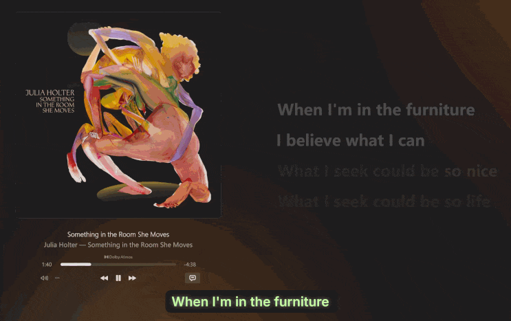

# Apple Music Lyrics

> Early development: features and configuration may change.

A lightweight Windows desktop app that displays synchronized Apple Music lyrics in an always-on-top overlay.




## Features

- Synchronized floating lyrics with single-line, two-line, and context layouts
- Strict Apple Music media-session selection by default
- Confidence-based lyric matching with Apple catalog verification
- Optional LRCLIB, QQ Music, and NetEase Cloud Music lookup, with background checks for missing word timing and translations
- Line-synchronized display from LRC, QQ QRC, and NetEase YRC lyrics
- Word-by-word highlighting when QQ or NetEase supplies word timing, with optional translated lyrics
- Pure Mode with content-sized bounds, configurable drag opacity, and click-through support
- Per-monitor-v2 DPI awareness, mixed-DPI positioning, and independent normal/Pure Mode placement
- Rendering-driven lyric transitions that follow WPF/DWM composition cadence
- Configurable colors, opacity, fonts, glow, timing offset, and visibility behavior
- Tabbed settings with independent original/translation typography and live previews
- Windows language detection, Simplified/Traditional Chinese and English, and drop-in JSON language packs
- Optional shared disk cache for LRCLIB, QQ, and NetEase, preserving translations and word timing with a configurable size limit
- System tray controls and persistent per-user settings

## Requirements

- Windows 10 version 19041 or later, or Windows 11
- Apple Music for Windows
- x64 [.NET 10 Desktop Runtime](https://dotnet.microsoft.com/download/dotnet/10.0)

The release is framework-dependent; the Desktop Runtime must be installed before starting the app.

## Installation

1. Download `AppleMusicLyrics-vX.X.X-win-x64.zip` from [Releases](../../releases).
2. Extract the archive.
3. Run `AppleMusicLyrics.App.exe`.

Settings and the catalog lookup cache are stored in `%LOCALAPPDATA%\AppleMusicLyrics`. On first launch after upgrading, legacy `settings.ini` and `catalog-cache.json` files beside the executable are copied there when possible.

## Usage

Use the tray icon to show/hide the overlay, open Settings, switch display modes, or toggle click-through behavior. In both Normal mode and Pure Mode, enabling Click through lets mouse input pass through to the window underneath, including while hovering. Disable Click through to interact with and drag the visible card. Normal mode and Pure Mode retain independent positions.

Settings are organized into five tabs, with Apply, Cancel, and Save available on every tab:

| Tab | Settings |
| --- | --- |
| 外观 | Original Latin/Chinese fonts, independent translation font and size, previews, colors, and glow |
| 歌词 | Word highlighting, translations, timing offset, and native timing correction |
| 窗口 | Layout, Pure Mode, click-through, and window/background opacity |
| 交互 | Automatic hiding, paused fading, and hover behavior |
| 高级 | Online sources, caching, compatibility, matching, and diagnostics |

Chinese glyphs and Chinese punctuation use the selected Chinese font; Latin text retains its own font. Font changes can be checked in the mixed-text preview and applied to the overlay without restarting. Existing settings files remain usable. Apply saves the current choices immediately; Cancel discards only edits made since the last Apply.

The language selector in the top-right corner defaults to following the Windows display language. It also offers explicit Simplified Chinese, Traditional Chinese, and English. Switching languages previews the interface immediately; Apply or Save retains the choice, and Cancel restores the last applied language. Additional languages can be installed as JSON files in the app's `Languages` folder; see [language packs](docs/localization.md).

Important settings include:

- **Lyrics lead time**: calibrates lyrics against audible playback.
- **Apply native timing correction**: honors Apple Music's TTML `lyricOffset` metadata.
- **Compatibility mode**: allows non-Apple media sessions; disabled by default to prevent another player or browser from taking over.
- **Low-confidence candidates**: trades matching accuracy for coverage; disabled by default.
- **Word-by-word highlighting**: follows real QRC/YRC word timing when available. With online lyrics enabled, it also requests background checks for word timing missing from the current lyrics. Lyrics without usable word timestamps keep the ordinary line display.
- **Show translations**: displays a translated line beneath the original when the lyric source provides a matching timestamped translation. With online lyrics enabled, it also requests background checks for missing translations. The app does not generate translations.
- **Online lyrics**: the online settings control Apple catalog verification and external lyric lookup. Initial lookup tries LRCLIB synchronized lyrics, QQ Music, and NetEase Cloud Music before using LRCLIB plain lyrics. Missing enabled features can trigger further background checks even when Apple or LRCLIB already supplies synchronized lines. Online service changes require an app restart; highlighting and translation toggles apply immediately.
- **Keep lyric cache**: the Advanced tab can retain completed lyrics from all three external providers across restarts, including supplied translations, line timing, and word timing. The shared capacity defaults to 64 MB and can be set from 1 to 1024 MB. Older, least recently used entries are removed when the quota is reached or reduced. Current disk usage is shown beside a one-click Clear cache action, which also works when retention or online lyrics are disabled. Clearing refreshes the usage immediately and preserves settings and the current lyric display. The retention switch and capacity apply immediately; retention remains disabled by default, preserving existing settings.
- **Pure mode drag opacity**: controls visibility while repositioning the card.
- **Diagnostic summary**: adds one compact line below the lyrics with the selected source and word/translation coverage. It has no scroll area or log panel. Use **View diagnostics** in the tray or Advanced settings to open the full report in a separate resizable window. That window shows missing-translation reasons and each source's query/retry/failure/selection results, remains independent of overlay opacity and click-through, and opens only when requested.

`CompositionTarget.Rendering` normally tracks the WPF/DWM composition cadence of the active display. The debug FPS value measures actual callbacks; it is not a promise that every system or driver will exactly match the monitor's advertised refresh rate.

## Network and privacy

Apple catalog verification and external lyric lookup are enabled by default and can be disabled in Settings for fully offline operation.

- **Apple iTunes Search API**: when local candidates are ambiguous, the app sends title and artist to verify the Apple catalog song ID.
- **LRCLIB**: the app sends title, artist, album, and duration for exact lookup, with title/artist search fallback. Synchronized lyrics are used when available; plain-only lyrics are displayed with an approximate evenly projected timeline and identified as `lrclib-plain` in diagnostics.
- **QQ Music**: the app sends title and artist to search QQ Music, then requests lyrics by the matched song ID. It is queried for missing lyrics or enabled word timing/translations missing from an existing Apple or LRCLIB result. QRC line and word timing is preserved, along with supplied translated lyrics.
- **NetEase Cloud Music**: the app sends title and artist to search NetEase, then requests lyrics by the matched song ID when earlier sources have no usable lyrics or lack an enabled feature. YRC and older klyric word timing is preserved, with LRC fallback and supplied translated lyrics.

The QQ and NetEase integrations use the request formats from the maintained LyricsKit fork linked below. They require no developer API key or account login. Their endpoints are undocumented platform interfaces and can change or reject requests. Server-issued anonymous cookies may be used in memory; the app does not read browser or player account cookies.

Requests run in cancellable background operations with bounded timeouts. When disk retention is enabled, successful results from LRCLIB, QQ, and NetEase share `%LOCALAPPDATA%\AppleMusicLyrics\external-lyrics-cache`; the size limit applies to these app-owned lyric entries, separately from Apple's own cache and the catalog lookup cache. Legacy `lrclib-cache.json` files are left untouched and are no longer written by the app. The app does not upload lyric cache files. Advanced storefront and timeout values remain available in `%LOCALAPPDATA%\AppleMusicLyrics\settings.ini`.

## How lyric selection works

1. Read Apple Music playback metadata through Windows System Media Transport Controls.
2. Scan Apple Music's local lyric cache and parse timed TTML.
3. Accept a close, unambiguous local match or verify ambiguous candidates against Apple's catalog.
4. Display a verified local match immediately. If no verified local lyrics exist and online lyrics are enabled, try LRCLIB, QQ Music, and NetEase Cloud Music in that order, showing a usable synchronized result as soon as it is available. Apply title, artist, and available duration checks to external candidates. Explicit featured-artist credits such as `(feat. Twista)` can be omitted by a source's title; matching normalizes those credits while rejecting conflicting guest credits and different live/remix/intro variants.
5. If highlighting or translations are enabled but missing, continue checking online sources in the background. Current lyrics stay visible during these checks; a matching source with richer data can replace them. Word timestamps and translations are used only when supplied by the source.
6. Use LRCLIB plain lyrics if no synchronized external result is available, with an approximate timeline.
7. Keep media/cache/network polling low-frequency while projecting playback and switching lines locally on visual frames.

A missing lyric is preferred over displaying a low-confidence wrong lyric unless the user explicitly enables low-confidence candidates.

## Development

### Prerequisites

- .NET SDK version pinned by [`global.json`](global.json)
- Windows 10/11

### Build and test

```powershell
dotnet restore AppleMusicLyrics.sln
dotnet build AppleMusicLyrics.sln -c Release --no-restore
dotnet test AppleMusicLyrics.sln -c Release --no-build
```

### Run

```powershell
dotnet run --project src/AppleMusicLyrics.App/AppleMusicLyrics.App.csproj
```

### Publish

```powershell
dotnet publish src/AppleMusicLyrics.App/AppleMusicLyrics.App.csproj -c Release -r win-x64 -p:PublishSingleFile=true -o artifacts/publish/win-x64
```

## Project structure

```text
src/
  AppleMusicLyrics.App/                    WPF desktop application
  AppleMusicLyrics.Application/            Runtime orchestration and use cases
  AppleMusicLyrics.Core/                   Core models and pure logic
  AppleMusicLyrics.Debugger/               Overnight diagnostic monitor
  AppleMusicLyrics.Infrastructure.Windows/ Windows integrations
tests/
  AppleMusicLyrics.Tests/                  Unit tests
```

## Known limitations

- Windows-only.
- Apple Music must be running for playback tracking.
- Offline playback requires Apple's cached lyrics or previously retained external lyrics. Keep external lyrics enabled to read the app's retained provider cache.
- QQ Music and NetEase Cloud Music endpoints have no official third-party availability guarantee and can be affected by platform changes, region restrictions, or rate limits.
- Word timing and translations depend on the source response. Missing or mismatched word timing falls back to line display; missing or unmatched translations are omitted.
- Layered transparent WPF windows can show driver-specific edge flicker while Pure Mode resizes; this requires hardware testing across systems.

## Contributing

Issues and pull requests are welcome. Keep matching changes accuracy-first and avoid introducing per-frame media, disk, or network I/O.

## License

Project-authored code is licensed under the [MIT License](LICENSE). The QQ Music and NetEase Cloud Music port includes files derived from LyricsKit under the [Mozilla Public License 2.0](licenses/MPL-2.0.txt). See [Third-party notices](THIRD_PARTY_NOTICES.md) for the covered files, fixed upstream revision, credits, and source availability instructions.

Software licenses cover the code. They do not grant authorization to use a music service's private interfaces or rights to reproduce, redistribute, or commercially use returned lyrics.

## Acknowledgments

Inspired by [ddddxxx's LyricsX](https://github.com/ddddxxx/LyricsX) for macOS. The QQ Music and NetEase Cloud Music integrations are ported from [MxIris-LyricsX-Project's maintained LyricsKit fork](https://github.com/MxIris-LyricsX-Project/LyricsKit), building on [ddddxxx's LyricsKit](https://github.com/ddddxxx/LyricsKit). The selected baseline is LyricsKit 1.8.3, commit [`6f071990d0c9c6f48d29284db805990bffb912ed`](https://github.com/MxIris-LyricsX-Project/LyricsKit/tree/6f071990d0c9c6f48d29284db805990bffb912ed), used by the maintained LyricsX v1.8.9 release. Credits and license details are preserved in [Third-party notices](THIRD_PARTY_NOTICES.md).
